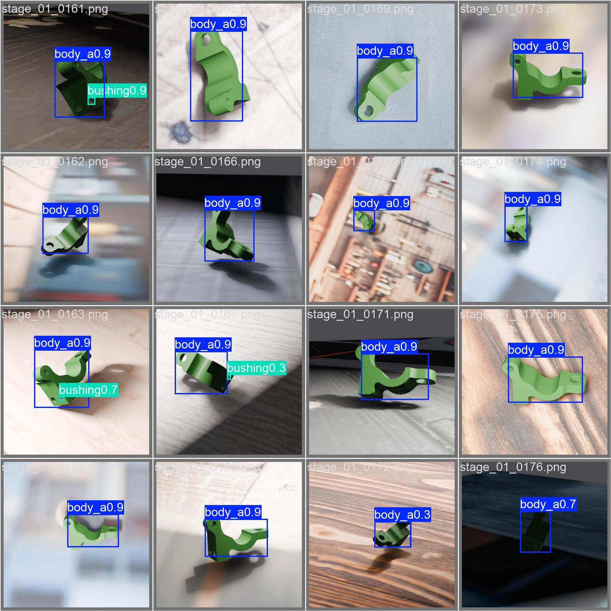
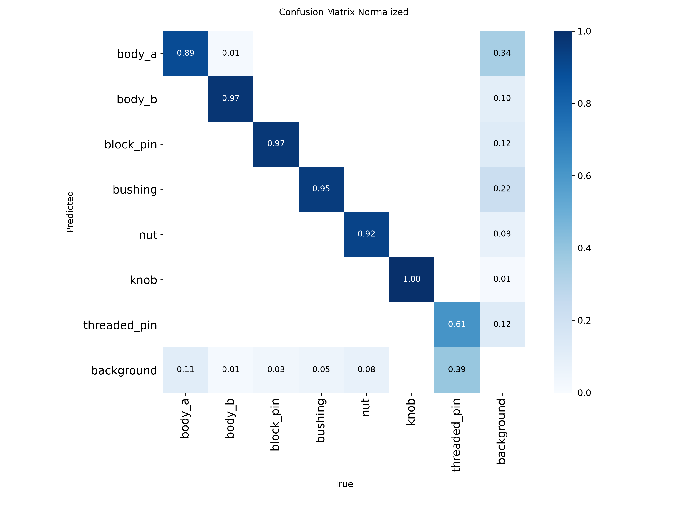
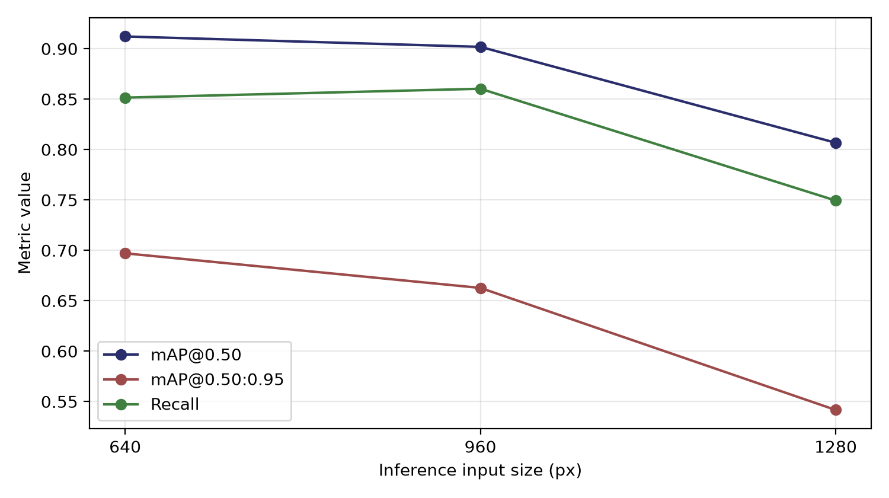
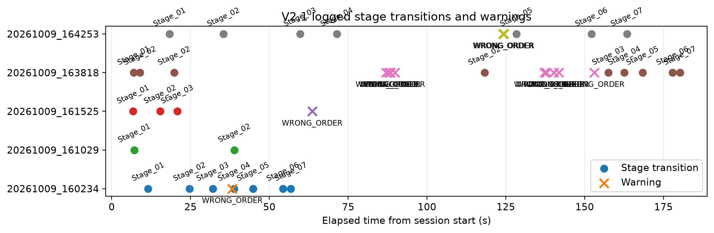

# Assembly Monitor V2.1

**A camera watches someone assembling a product by hand, and writes down what happened.**

Which components are on the bench, which assembly stage the operator has reached, how long each stage took, and whether the steps were done in the right order - all of it recorded automatically, from one ordinary webcam.



*The detector on held-out images: seven component classes with confidence scores. This is only the first step - the system still has to work out what these detections* mean *in process terms.*

Built for my M.Sc. thesis *AI-Supported Ergonomic and Productivity Analysis in Manual Assembly* at the Institute of Product Life Cycle Management (PLCM), Technische Universität Darmstadt.

> **Project family:** [V1 Classical CV](https://github.com/MehulTU/Assembly-Monitoring-System) · [V2 YOLO pipeline](https://github.com/MehulTU/Assembly-Monitoring-System-V2) · **V2.1 (this repo)** · Author: [@MehulTU](https://github.com/MehulTU)

---

## Quick start

```bash
pip install -r requirements.txt
python Assembly_monitor/check_setup.py     # tells you what is missing
python Assembly_monitor/main.py            # run the live system
```

You need Python 3.12, a webcam, and trained weights at `weights/best.pt` - these are **not in the repository**; see [`weights/`](weights) for the download.

Full operating instructions, keyboard controls and settings: **[`Assembly_monitor/README.md`](Assembly_monitor/README.md)**.

---

## Why this exists

Manual assembly stays human in small-batch, high-variety production, because a person adapts to a new product variant immediately and a machine does not. But that work gets measured by stopwatch and manual observation, neither continuous nor repeatable.

So the situation is this: everything happening at the bench is completely visible, and none of it exists as data.

A second problem shaped the whole project. **There were no labelled images of these components anywhere.** They are specialised, one-off parts, and hand-annotating every new product variant does not scale. Any solution that needs a human to draw thousands of boxes first is not a solution.

## How it works

```
camera frame
   → component detection            YOLO, 7 classes
   → composition per frame          which parts, how many
   → candidate assembly stage       matched against the 7-stage reference
   → temporal confirmation          3 of the last 5 frames must agree
   → confirmed stage + process log  timestamp, duration, WRONG_ORDER warnings
```

The design decision that matters: **perception and interpretation are separate layers.** The detector only reports what it sees. A state machine decides what that means, driven by a sequence table rather than by code. Either side can be swapped without touching the other - which is what makes the method portable to a different product.

A single noisy frame can never move the process state. That is what the 3-of-5 confirmation rule is for.

### The product being assembled

An industrial lever-lock subassembly: **8 physical components, 7 detector classes** (the two bushings are the same class), built in **7 defined stages**.

| | |
| --- | --- |
| **Classes** | `body_a` · `body_b` · `block_pin` · `bushing` · `nut` · `knob` · `threaded_pin` |
| **Stages** | S01 base body + 1 bushing → S02 + 2 bushings → S03 + body_b → S04 + block_pin → S05 + nut → S06 locking subassembly (threaded pin + knob) → S07 complete |

---

## Where the training data came from

No labelled images existed, so the dataset was **generated from the CAD model** instead of photographed and annotated.

Components are placed in a parameterised Blender scene with randomised pose, camera position, lighting and background. The renderer produces the image and the label *together*, so every bounding box is computed from known 3-D geometry and a known camera - **exact by construction, with no box drawn by hand.**

**6,551 images · 8,714 annotated instances · 3,916 train / 1,316 val / 1,319 test**, from five sources covering single parts and ordered subassembly scenes.

Manual annotation was considered and rejected: it costs effort for every image, produces inconsistent labels, and has to be repeated for every new product, which defeats the point of a transferable method. This part is the most reusable result of the thesis: a new product needs its CAD model and nothing else.

The generation pipeline is a separate Blender project and is **not published here**, because its scripts embed CAD geometry supplied by the industrial partner. The procedure is documented at method level in Appendix B of the thesis, so it can be reproduced from your own CAD.

---

## Results

### Detector - offline, on held-out synthetic images

| Split | Images | Precision | Recall | mAP@0.50 | mAP@0.50:0.95 |
| --- | --- | --- | --- | --- | --- |
| Validation | 1,316 | 91.64 % | 83.14 % | 91.93 % | 69.38 % |
| Test (held out) | 1,319 | 89.15 % | 86.24 % | 92.54 % | 69.90 % |



The weakest classes are `threaded_pin` (recall 70.56 % — small, thin, and partly inside the body once inserted) and `body_b` (mAP@0.50:0.95 61.61 % — occluded once the halves are joined). Both are occlusion and scale effects, not the detector confusing one class for another.

The gap between the two mAP columns says something specific: the detector finds the right objects, but the boxes are not always tightly placed. That is a localisation gap, not a miss rate and for counting *which components are present*, the looser threshold is the relevant one.

### Why 640 px



Larger inputs did not improve the small-part classes enough to justify the frame-rate cost on the target hardware: a laptop, running at 10–14 fps.

### The integrated system, across four live sessions



60 state records and 11 `WRONG_ORDER` warnings; session durations 64.52–184.23 s; stage times 0.17–13.12 s. The raw logs are in [`logs/process/`](logs/process), and the scripts that rebuild these figures from them are in [`V21_validation_evidence_pack/`](V21_validation_evidence_pack).

### What the evidence does and does not support

Stated plainly, because the distinction is the point:

| | |
| --- | --- |
| **Quantified** | Detector performance on held-out *synthetic* images; the camera-viewpoint and resolution studies. |
| **Demonstrated, not scored** | The integrated runtime. The live sessions have no independently annotated record of the physical stage transitions, or of when deviations were introduced. So the 11 warning records establish that the warning function was **active** - not its sensitivity, its specificity, or its response delay. |
| **Not implemented** | Human pose estimation and RULA/REBA ergonomic scoring. These are defined in the requirements and the architecture provides the interface, but they were not built and not evaluated. |

The thesis targets of workflow accuracy > 90 % and timing error < 10 % therefore remain **unscored**, and no end-to-end "system accuracy" figure is reported anywhere. Turning the descriptive counts into rates requires a controlled trial that records stage transitions and error-introduction times independently - which is the first item of future work, not a detail.

---

## Repository map

| Folder | What is in it |
| --- | --- |
| [`Assembly_monitor/`](Assembly_monitor) | **The software.** Start here - it has its own README |
| [`Assembly_monitor/decision/`](Assembly_monitor/decision) | The interpretation layer: assembly state machine, position validator, seat finder |
| [`Assembly_monitor/thesis_results/`](Assembly_monitor/thesis_results) | Detector metrics, resolution study, trial results - the figures and LaTeX tables used in the thesis |
| [`Assembly_monitor/validation_output/`](Assembly_monitor/validation_output) | Session summaries, transition and warning events from the live runs |
| [`V21_validation_evidence_pack/`](V21_validation_evidence_pack) | Scripts that rebuild the validation figures and tables from the raw logs |
| [`logs/`](logs) | V1 baseline session CSVs and V2.1 process logs (JSONL) - the raw evidence behind every number above |
| [`scripts/`](scripts) | Dataset preparation, annotation export, training, offline inference |
| [`datasets/`](datasets) | Dataset metadata and annotation exports. See the [note](datasets/yolo_dataset_v1) on the early two-class dataset |
| [`archive/`](archive) | Superseded code, kept for traceability |

### What is deliberately not in the repository

| Excluded | Why |
| --- | --- |
| `weights/*.pt` | Model checkpoints, ~20 MB each - see [`weights/`](weights) |
| `recordings/`, `*.mp4` | Session video |
| Dataset image and label folders | Thousands of training images |
| `runs/` | Ultralytics training output |
| `venv/`, `__pycache__/` | Environment and build artefacts |

The trained checkpoint is published on the [Releases page](../../releases).

---

## How this repository came to exist

| Repo | What it was |
| --- | --- |
| [V1](https://github.com/MehulTU/Assembly-Monitoring-System) | Classical computer vision - greyscale, background subtraction, morphology, contour motion score, temporal filter. It produced activity intervals and timing that worked. But every event carried the same label: `ACTIVE`. The system knew work was happening and not *which* work. That limitation is what motivated V2. |
| [V2](https://github.com/MehulTU/Assembly-Monitoring-System-V2) | The first YOLO pipeline. Object detection was added inside the existing modular architecture, which did not have to change - the point the architecture was designed for. |
| **V2.1 (here)** | The assembly state machine, structured process logging, sequence-deviation warnings, the validation tooling and the thesis results. |

Early classical-CV learning scripts from V1 are kept in `Assembly_monitor/src(all basic codes)/`.

## Built with

Python · OpenCV · Ultralytics YOLO · PyTorch · NumPy · Blender (synthetic data generation) · CVAT (annotation)

## Author

**Mehul Patil** — M.Sc. Aerospace Engineering, Technische Universität Darmstadt, Germany.
Master's thesis at the Institute of Product Life Cycle Management (PLCM).
